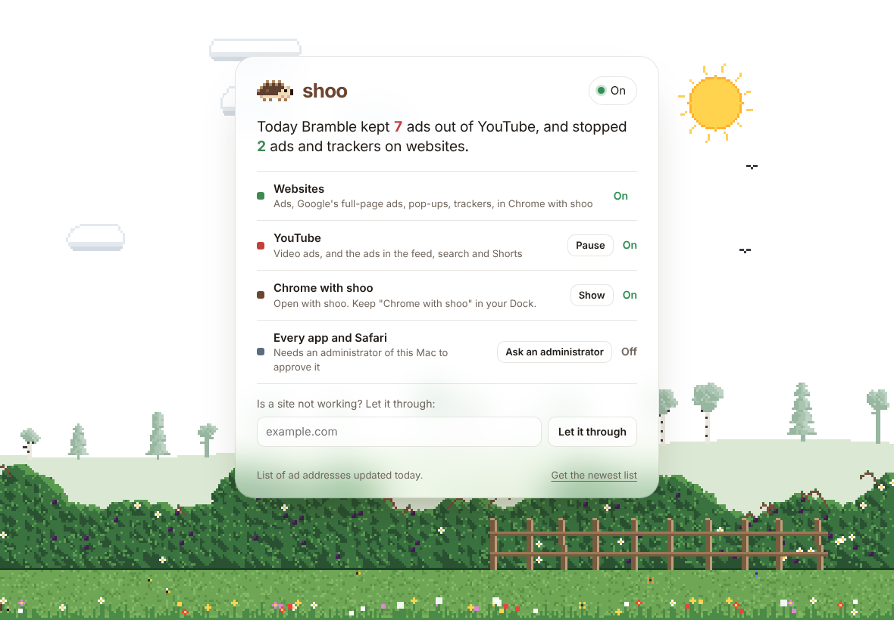

# shoo

**Blocks ads**: Google's full-page "vignette" ads, banners, pop-ups, trackers, and the ads on YouTube. **No administrator needed.** It's an app, not a browser extension, and Bramble the hedgehog keeps watch from a little hedgerow.



## What it blocks

| | How |
|---|---|
| **Websites**: ads, Google's full-page ads, pop-ups, trackers | Your browser is told to send ad and tracker addresses (about 100,000 of them) to shoo, which stops them. |
| **YouTube**: video ads, and the ads in the feed, search, "up next" and Shorts | YouTube's ads come from the same servers as its videos, so shoo reads YouTube's pages on your Mac and takes the ads out before your browser shows them. |

**Where:** in **Chrome, Edge or Brave**, when you open it through shoo (the **Chrome with shoo** app). That needs nobody's permission.

**Every app and Safari too:** that needs an administrator of the Mac to approve it once. Click **Ask an administrator** in shoo's window, or type `shoo whole-mac`.

No ad blocker catches every ad. YouTube changes its site often, so now and then an ad may slip through until shoo is updated.

## Install it

**On a Mac:** open Terminal, paste this and press Enter:

```sh
curl -fsSL https://djp7.pythonanywhere.com/shoo/install.sh | sh
```

Then open a **new** Terminal window and type `shoo`. Already have [pca](https://github.com/dpatel7-dev/Project-CLI-Access)? Type `pca`, pick **shoo** (Bramble the hedgehog) and press Enter.

The first time:

1. shoo shows what it's going to do. Press Enter at **Turn shoo on?**
2. macOS may ask for **your own Mac password**, to trust shoo's YouTube-only certificate.
3. If Chrome is open, shoo asks to close it and open it again with shoo. Your tabs come back.

## Every day

- **Open your browser with shoo:** use the **Chrome with shoo** app (it's in your Applications folder). Drag it into your Dock and use it instead of the normal Chrome icon.
- **See shoo's window (the dashboard):** open the **shoo** app. Press Cmd+Space, type `shoo` and press Enter. Or type `shoo` in Terminal.
- If you open Chrome the normal way, its ads get through. shoo's window says so and has a **Reopen with shoo** button.

## Commands

| Command | What it does |
|---|---|
| `shoo` | open shoo's window (the first time, it sets itself up) |
| `shoo chrome` | open Chrome with shoo (also `shoo edge`, `shoo brave`) |
| `shoo on` / `shoo off` | turn ad blocking on or off |
| `shoo status` | what shoo is doing |
| `shoo allow example.com` | let a site through, if blocking it broke something |
| `shoo block example.com` | block it again |
| `shoo list` | download the newest list of ad addresses |
| `shoo whole-mac` | block ads in every app and Safari too (an administrator approves it) |
| `shoo update` | get the newest version of shoo |
| `shoo uninstall` | turn it off and remove shoo completely |

## Safe by design

- **No administrator needed** for the browser way: it only uses settings your own account is allowed to change.
- **It won't change a Mac that a school or company manages.** If the Mac is enrolled in device management, shoo stops and says so.
- **It won't go around a filter.** If the Mac already sends web traffic through a filter or proxy (often set up by a school or a parent), shoo won't open your browser around it.
- **If shoo isn't running, nothing breaks.** Your browser simply goes straight to every site, with no ad blocking.
- **The certificate works for YouTube only.** To read YouTube's pages, shoo makes its own certificate on your Mac, limited to youtube.com and youtube-nocookie.com. It can't be used for any other website, even by someone who copied it.
- **Nothing leaves your Mac.** shoo doesn't collect or send anything. It only downloads the public list of ad addresses ([StevenBlack/hosts](https://github.com/StevenBlack/hosts)) and its own updates.
- `shoo uninstall` removes the apps, the background helper and the certificate.

## If something goes wrong

- **A website looks broken:** in shoo's window, type the site under "Is a site not working?" and click **Let it through**. Or type `shoo allow example.com`.
- **YouTube won't load:** click **Pause** next to YouTube in shoo's window, or type `shoo off`.
- **Ads in Chrome:** check Chrome was opened with **Chrome with shoo**. `shoo status` tells you.
- **Safari and other apps** only get ad blocking in the whole-Mac mode (an administrator approves it).
- **See what's happening:** `shoo status`. The helper's log is in `~/.shoo/shoo.log`.

## How it works (for the curious)

- Chrome, Edge and Brave are opened with `--proxy-pac-url`, pointing at shoo's proxy auto-config file on `127.0.0.1:8689`. Browsers only accept a PAC file of about 1 MB, so the 100,000 ad addresses travel as a Bloom filter (`src/bloom.js`); the blocker on port 8690 checks the real list and lets the rare false match through.
- `src/proxy.js` and `src/prune.js` handle YouTube: shoo removes `adPlacements`, `playerAds`, ad slots and promoted items from YouTube's pages and the player's data.
- `src/ca.js` builds the YouTube-only certificate (name constrained, no IP addresses).
- Whole-Mac mode (`src/mac.js`, `src/hosts.js`) uses its own section of `/etc/hosts` and the system proxy settings, approved by an administrator.
- A small helper starts when you log in (`~/Library/LaunchAgents/dev.dpatel7.shoo.plist`).

Tests: `node --test` (Node 18 or newer). No dependencies.
